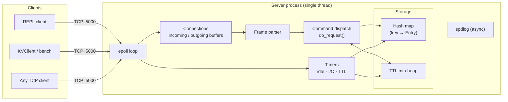
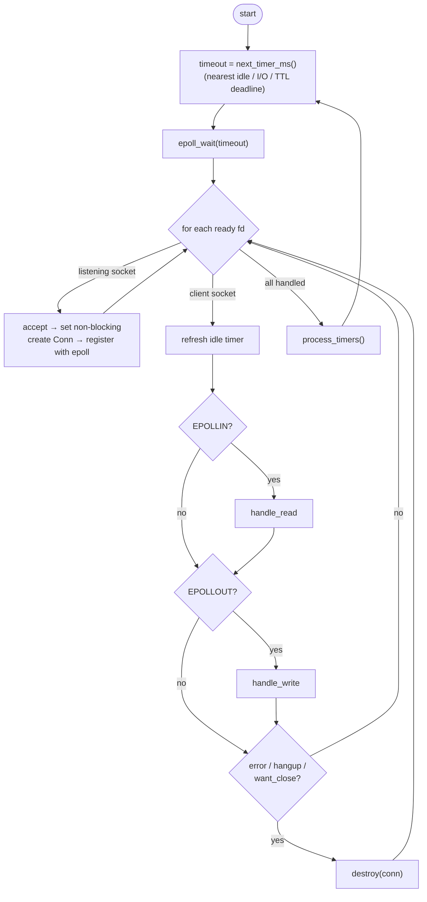
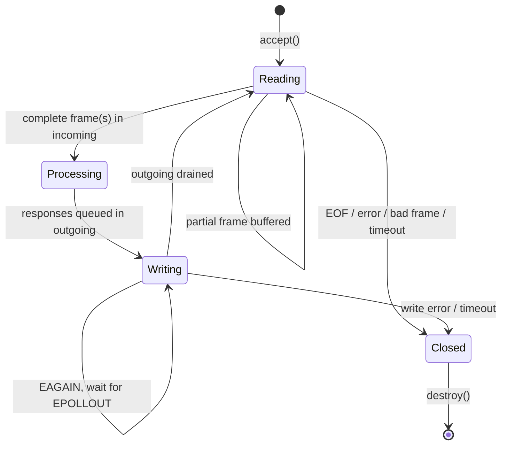
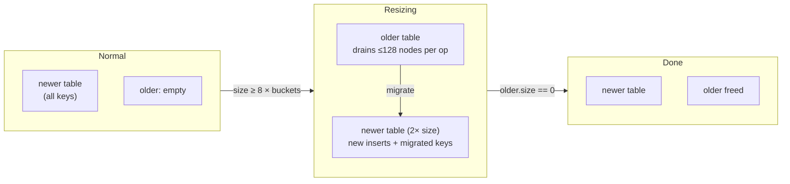
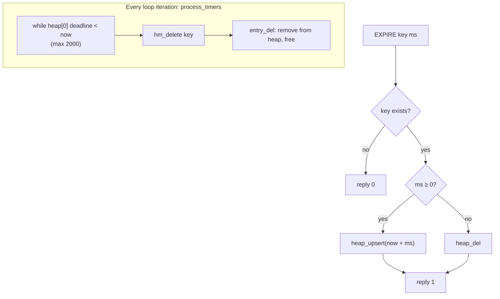

# Architecture Overview

A single-threaded, in-memory key-value store in C++17. It uses an `epoll` event loop, a custom hash table with incremental resizing, and a min-heap for key expiry. Clients talk to it over a custom binary TCP protocol ([protocol](protocol.md), [API](../api-reference.md)).

## Contents

1. [Build and run](#1-build-and-run)
2. [System architecture](#2-system-architecture)
3. [Event loop](#3-event-loop)
4. [Connection lifecycle](#4-connection-lifecycle)
5. [Storage engine](#5-storage-engine)
6. [Client](#6-client)
7. [Known issues](#9-known-issues)

---

## 1. Build and run

Requires `g++` with C++17, `spdlog` and `fmt`. Tests also need Catch2.

```bash
make all                     # builds build/server and build/client
make run_server              # foreground
make run_client              # REPL (connects to 127.0.0.1:5000)
make tests && make run_tests # Catch2 unit tests
make run_bench               # write benchmark (server must be running)
```

`MODE` selects the compiler profile:

| `MODE`            | Flags                                                   |
| ----------------- | ------------------------------------------------------- |
| `debug` (default) | `-g -O0 -fsanitize=address,undefined`, debug-level logs |
| `release`         | `-O2 -DNDEBUG`                                          |

Note that `make run_server_prod` still uses the default `debug` profile. Use `make MODE=release run_server_prod` for an optimised binary.

Docker:

```bash
docker compose up -d server
docker compose run --rm client
docker compose down
```

---

## 2. System architecture



Everything runs on one thread. There are no locks, and a command runs to completion before the next one starts. All global state lives in one struct, `g_data`:

| Member        | Role                                                        |
| ------------- | ----------------------------------------------------------- |
| `db` (`HMap`) | The key space                                               |
| `heap`        | Expiry deadlines for keys that have a TTL                   |
| `fd2conn`     | File descriptor → `Conn*` lookup table                      |
| `idle_list`   | Connections ordered by last activity                        |
| `io_list`     | Connections with a request in flight, ordered by start time |
| `epoll_fd`    | The epoll instance                                          |

---

## 3. Event loop



Key points:

- **Non-blocking I/O.** Every socket is non-blocking. `handle_read` reads in 64 KiB chunks until `EAGAIN`, which is required because client sockets are registered edge-triggered (`EPOLLET`).
- **Write path.** After parsing, if `outgoing` has data, `set_write` adds `EPOLLOUT` to the socket's events. `handle_write` writes until the buffer is empty or `EAGAIN`, then removes `EPOLLOUT` again.
- **Sleep time** is the nearest deadline across idle timeouts, I/O timeouts and key expiry, so the server wakes only when something is due. With nothing pending it blocks indefinitely.

### Timers

| Timer   | Value   | Data structure                            | On expiry                           |
| ------- | ------- | ----------------------------------------- | ----------------------------------- |
| Idle    | 30 s    | `idle_list` (moved to tail on each event) | Close connection                    |
| I/O     | 10 s    | `io_list`                                 | Close connection                    |
| Key TTL | per key | min-heap by deadline                      | Delete key (max 2000 per iteration) |

Because both connection lists are ordered by deadline, checking them only ever looks at the head.

---

## 4. Connection lifecycle



Each `Conn` holds:

| Field                                     | Purpose                               |
| ----------------------------------------- | ------------------------------------- |
| `fd`                                      | Socket                                |
| `want_read` / `want_write` / `want_close` | Intent flags checked by the loop      |
| `incoming` / `outgoing`                   | Byte buffers (`std::vector<uint8_t>`) |
| `last_active_ms`, `idle_node`             | Idle-timer bookkeeping                |
| `io_start_ms`, `io_node`                  | I/O-timer bookkeeping                 |

`destroy()` removes the fd from epoll, clears its `fd2conn` slot, unlinks it from both timer lists, closes the socket and frees the `Conn`.

---

## 5. Storage engine

### 5.1 Entry

A key's data lives in one heap-allocated `Entry`:

```cpp
struct Entry {
    HNode       node;      // intrusive hash-map node (next, hash)
    std::string key;
    std::string value;
    size_t      heap_idx;  // position in the TTL heap, or (size_t)-1 if no TTL
    uint32_t    type;      // T_STR today; T_ZSET declared for future use
};
```

The hash map stores only `HNode*`. The server recovers the owning `Entry` with `container_of`, so the map needs no allocations of its own.

### 5.2 Hash map (`hashtable.cpp`)

- **Layout:** an array of buckets, each a singly linked chain. The bucket count is a power of two (starts at 4), so the index is `hash & mask`.
- **Hash function:** 32-bit FNV-1a over the key bytes (`utils.h`).
- **Resize trigger:** when `size ≥ buckets × 8` (max load factor 8).
- **Progressive rehashing:** the map holds two tables, `newer` and `older`. A resize doubles `newer` and keeps the old table, then moves up to **128 nodes** per `lookup` or `insert`. This spreads the cost of a resize over many operations instead of stalling the loop.



Lookups check `newer` first and then `older`. Deletes check `older` first and then `newer`.

| Function    | Behaviour                                                  |
| ----------- | ---------------------------------------------------------- |
| `hm_lookup` | Migrates a batch, then searches both tables                |
| `hm_insert` | Inserts into `newer`, may start a resize, migrates a batch |
| `hm_delete` | Unlinks and returns the node (caller frees it)             |
| `hm_clear`  | Frees both bucket arrays                                   |
| `hm_size`   | `older.size + newer.size`                                  |

### 6.3 TTL heap (`heap.cpp`)

A binary **min-heap** of `{deadline_ms, size_t* ref}`. The smallest deadline is always at index 0, so the server sees the next expiry in O(1).

`ref` points at the owning entry's `heap_idx`. Every time an item moves inside the heap, the heap writes its new position through `ref`. That lets the server update or remove a specific key's TTL in O(log n) without searching.

| Operation      | Cost     | Used by                             |
| -------------- | -------- | ----------------------------------- |
| `heap_upsert`  | O(log n) | `EXPIRE` with ttl ≥ 0               |
| `heap_del`     | O(log n) | `EXPIRE` with ttl < 0, key deletion |
| Peek `heap[0]` | O(1)     | `next_timer_ms`, `process_timers`   |

Deadlines use `CLOCK_MONOTONIC` in milliseconds.

### 6.4 Expiry flow



---

## 6. Client

**REPL (`src/client.cpp`)**: connects to `127.0.0.1:5000`, shows a `cacheline>` prompt, splits each line on whitespace into a command, sends it as one frame, and prints the reply. It uses `poll()` on stdin and the socket, and `exit()` quits.

**`KVClient` (`include/client.h`)**: a small class with `open()`, `send(vector<string>)` and `receive()`. It uses blocking `read_full` / `write_all` loops and a fixed 4 KiB frame limit. The benchmark uses it.

---

## 8. Logging, tests, benchmarks, CI

- **Logging:** `spdlog` with an async logger (65,536-slot queue, drops the oldest messages on overflow). It writes to the console and to `logs/kvstore.log` (rotating, 100 MB × 5 files). The server logs at `info` level by default, and warnings flush immediately.
- **Tests:** Catch2 tests for the heap (`AddValues`, `DeleteValues`). `tests/unit/test_hashtable.cpp` exists, but `make tests` currently builds only the heap test.
- **Benchmark:** `bench/server/benchmark_write.cpp` warms up, then sends 10,000 `SET`s through `KVClient` and reports send and receive latency percentiles.
- **CI:** on push and pull request to `main`, runs `make run_tests` and then `make run_bench`. Separate workflows build and deploy the Docker image.

---

## 9. Known issues

Item 1 was reproduced against a build of the current `main`. The rest come from reading the code.

1. **Active connections are dropped after ~10 s.** In `handle_write`, once the output buffer drains, the connection is detached from `io_list` and then **re-inserted** instead of just removed, so the I/O timer keeps running. In a test, a client sending a `PING` every 3 s was reset at about 10 s. The server then logged an I/O-timeout teardown with a garbage fd (`epoll_ctl DEL failed for fd 870978591`), which points to a use-after-free of a `Conn`. The related `dlist_init(&conn->io_node)` in `handle_read` can also corrupt the list if the node is still linked.
2. **The Docker client cannot reach the server container.** `docker-compose.yaml` runs the client with `--host server`, but `client.cpp` ignores arguments and hardcodes `127.0.0.1`.
3. **REPL prints strings incorrectly.** The `(str)` `printf` in `client.cpp` passes `len` and the data pointer in the wrong positions for its format string. The `KVClient` class and raw protocol are unaffected.
4. **`FLUSH` leaks entries.** `hm_clear` frees the bucket arrays but not the `Entry` objects, and the TTL heap is not cleared. Entries with a TTL are freed when their deadline passes (with a spurious warning), but entries without one are never freed.
5. **`k_max_ttl`, `ERR_BAD_TYP`, `T_ZSET` and `TAG_ARRAY` / `TAG_DOUBLE` are defined but unused.**
