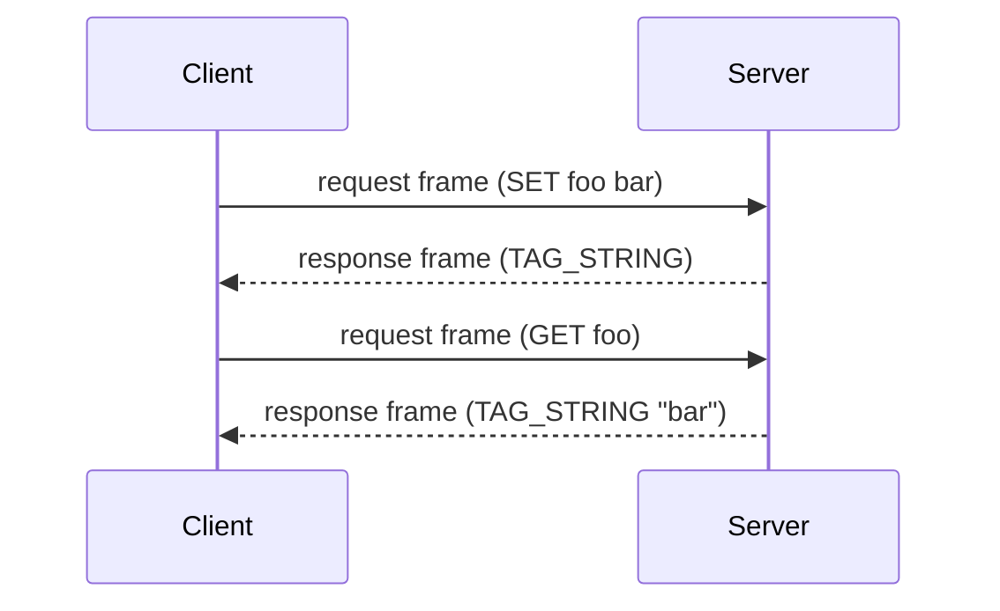
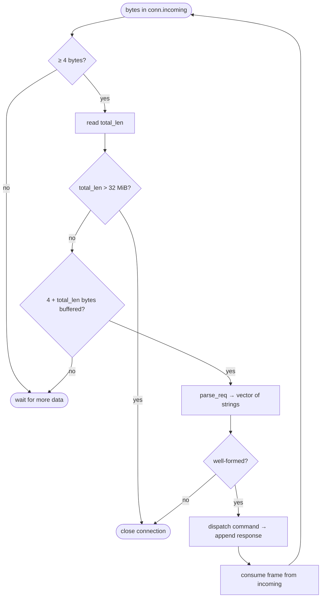
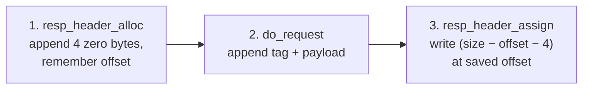
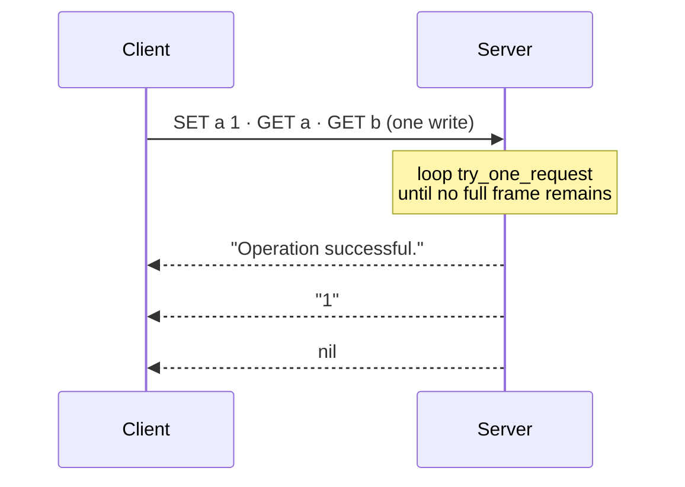

# Protocol

A length-prefixed binary protocol over TCP (default port **5000**). All integers are **little-endian**.

Every byte layout and example on this page was checked against a running server.

---

## 1. Overview

One **request frame** in, one **response frame** out. Requests on a connection are answered strictly in order, and a client may send several before reading any reply (pipelining).



---

## 2. Request frame

A request is a command split into strings: the command name first, then its arguments.

```
 0        4        8
 ┌────────┬────────┬────────┬─────────────┬────────┬─────────────┬─────
 │total_len│ nstr  │ len₁   │ arg₁ bytes  │ len₂   │ arg₂ bytes  │ ...
 │  u32   │  u32   │  u32   │  len₁ bytes │  u32   │  len₂ bytes │
 └────────┴────────┴────────┴─────────────┴────────┴─────────────┴─────
          └────────────── covered by total_len ──────────────────────┘
```

| Field       | Size     | Meaning                                                     |
| ----------- | -------- | ----------------------------------------------------------- |
| `total_len` | 4 B      | Bytes that follow this field (`nstr` + all argument fields) |
| `nstr`      | 4 B      | Number of string arguments, including the command name      |
| `lenᵢ`      | 4 B      | Length of the i-th argument                                 |
| `argᵢ`      | `lenᵢ` B | Raw bytes, no terminator                                    |

Rules:

- `total_len` must be ≤ **32 MiB** (`32 << 20`); otherwise the server closes the connection.
- The arguments must consume `total_len` exactly. Truncated fields or trailing bytes make the frame malformed, and the server closes the connection.
- The command name is matched **case-sensitively** (`GET`, not `get`).

### Example: `SET foo bar`

```
19 00 00 00            total_len = 25
03 00 00 00            nstr = 3
03 00 00 00  53 45 54  len=3  "SET"
03 00 00 00  66 6F 6F  len=3  "foo"
03 00 00 00  62 61 72  len=3  "bar"
```

`total_len` = 4 (`nstr`) + 3 × 4 (length prefixes) + 3 + 3 + 3 (payloads) = 25.

---

## 3. Response frame

```
 ┌───────────┬─────────┬──────────────────┐
 │ total_len │   tag   │     payload      │
 │   u32     │   u8    │ depends on tag   │
 └───────────┴─────────┴──────────────────┘
             └─ covered by total_len ─────┘
```

### Type tags

| Tag    | Name         | Payload                                  | Emitted by server today? |
| ------ | ------------ | ---------------------------------------- | ------------------------ |
| `0x00` | `TAG_NIL`    | none                                     | yes                      |
| `0x01` | `TAG_ERR`    | `code: u32`, `msg_len: u32`, `msg` bytes | yes                      |
| `0x02` | `TAG_INT`    | `value: i64`                             | yes                      |
| `0x03` | `TAG_STRING` | `len: u32`, `bytes`                      | yes                      |
| `0x04` | `TAG_DOUBLE` | `value: f64` (IEEE 754)                  | defined, not used yet    |
| `0x05` | `TAG_ARRAY`  | `count: u32`, then `count` values        | defined, not used yet    |

For arrays, each element is a full tag + payload without its own `total_len`.

### Error codes

| Code | Name          | When                                                              |
| ---- | ------------- | ----------------------------------------------------------------- |
| 1    | `ERR_UNKNOWN` | Unknown command, or wrong number of arguments for a known command |
| 2    | `ERR_TOO_BIG` | The response would exceed 32 MiB                                  |
| 3    | `ERR_BAD_ARG` | An argument has the wrong type (for example a non-integer TTL)    |
| 4    | `ERR_BAD_TYP` | Reserved, not used yet                                            |

### Examples

`GET foo` → `"bar"`:

```
08 00 00 00   total_len = 8
03            TAG_STRING
03 00 00 00   len = 3
62 61 72      "bar"
```

`GET missing` → nil:

```
01 00 00 00   total_len = 1
00            TAG_NIL
```

`EXISTS foo` → `1`:

```
09 00 00 00   total_len = 9
02            TAG_INT
01 00 00 00 00 00 00 00   value = 1
```

Unknown command → error:

```
19 00 00 00   total_len = 25
01            TAG_ERR
01 00 00 00   code = 1 (ERR_UNKNOWN)
10 00 00 00   msg_len = 16
55 6E 6B 6E 6F 77 6E 20 43 6F 6D 6D 61 6E 64 2E   "Unknown Command."
```

---

## 4. How the server reads a request

Bytes arrive in arbitrary chunks, so the server buffers them per connection and only acts on **complete** frames (`try_one_request`).



`parse_req` returns `0` on success and `-1` on a malformed frame (truncated field, or bytes left over after the last argument).

---

## 5. How the server writes a response

The length goes first but is only known after the payload is built, so the server reserves the header and fills it in afterwards:



If the payload exceeds 32 MiB, the buffer is cut back to the header and replaced with a `TAG_ERR` / `ERR_TOO_BIG` response.

Finished responses sit in `conn.outgoing`. The server then enables `EPOLLOUT` on that socket and flushes on the next loop iteration, handling partial writes.

---

## 6. Pipelining

Frames sent back-to-back are processed in order in a single read pass, and replies are queued in the same order:



Verified: three pipelined requests return three responses in order.

---

## 7. Connection closure

The server closes a connection when any of these happen:

| Cause           | Detail                                                                                                                               |
| --------------- | ------------------------------------------------------------------------------------------------------------------------------------ |
| Oversized frame | Request `total_len` > 32 MiB                                                                                                         |
| Malformed frame | `parse_req` fails                                                                                                                    |
| Client EOF      | `read()` returns 0                                                                                                                   |
| I/O error       | `read()` / `write()` fails with anything except `EAGAIN` / `EWOULDBLOCK`                                                             |
| Idle timeout    | No activity for **30 s**                                                                                                             |
| I/O timeout     | A request/response exchange stays in flight for more than **10 s** (see known issue 1 in the [overview](overview.md#9-known-issues)) |

---

## 8. Limits

| Limit                                           | Value                            |
| ----------------------------------------------- | -------------------------------- |
| Max request or response body                    | 32 MiB (server)                  |
| Max request size accepted by the bundled client | 4096 B (`client.h`, `k_max_msg`) |
| Idle timeout                                    | 30 s                             |
| I/O timeout                                     | 10 s                             |
| Max events per `epoll_wait`                     | 64                               |
